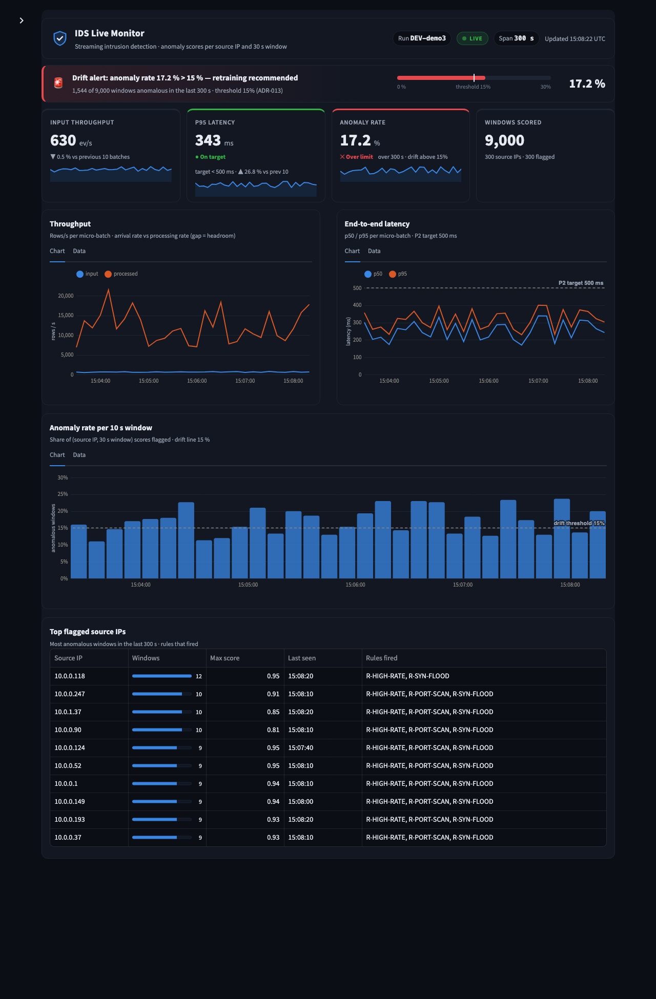

# Module 4 — Storage, Dashboard and Benchmarking

| | |
|---|---|
| Owner | **Vidhi Kant Gupta** |
| Python package | `ids_monitor` |
| Status | Building (canonical owner build, started 2026-11-01) |
| Contracts owned | C-04 Anomaly Store |
| Contracts consumed | C-05 Pipeline Metrics (M3), C-06 Runtime Config and Control (M1) |

## Purpose
This module owns the Cassandra table where scored windows land, and the read access to it. It also owns the live Streamlit
operations dashboard with its drift alert (G6), and the scripted benchmark harness that produces every number in the report
(E1–E3, P1, latency, recovery, FPR).

## Scope (features)
| Feature | Spec | Status |
|---|---|---|
| M4-F01 Store schema and access | specs/M4-F01-store-schema-access/ | Implemented (see spec AC table) |
| M4-F02 Live dashboard | specs/M4-F02-dashboard/ | Verified (1.1.0) |
| M4-F03 Benchmark harness | specs/M4-F03-benchmark-harness/ | Implemented 1.1.0 (AC-01..07); live smoke and full runs at I-03 / P3 |
| M4-F04 Results and report figures | specs/M4-F04-results-analysis/ | Implemented (AC-01..05); run on real results after P3 |
| M4-F04 Results analysis | specs/M4-F04-results-analysis/ | Not started |

## Provides → consumers
| What | Contract | Consumer | Mock for others |
|---|---|---|---|
| Keyspace and `window_scores` DDL | C-04 | M3 (writer) | `contracts/schemas/ids_schema.cql` |
| Dashboard, benchmark results, figures | — | Team / report | — |

## Consumes ← providers
| What | Contract | Provider | Mock I use until integration |
|---|---|---|---|
| Scored windows | C-04 | M3 | M4-F01 synthetic generator (`make mock`) |
| Per-batch metrics and runs | C-05 | M3 | M4-F01 synthetic generator (`make mock`) |
| Control CLIs (topic, producer, job, worker restart) | C-06 | M1, M3 | harness `--dry-run` |

## Quick start
```bash
make install
make test
make contract-test
make run    # apply + check the C-04/C-05 schema, then serve the dashboard on http://localhost:8501
make mock   # synthetic C-04/C-05 rows for the last 300 s (M4-F01)
make integration-test   # live tests; needs Cassandra on CASSANDRA_HOSTS:CASSANDRA_PORT
```

### M4-F01 commands (C-06 conventions: exit 0 ok / 1 runtime / 2 usage, one JSON summary line last)
```bash
python -m ids_monitor.schema apply              # create keyspace + tables, then check for drift
python -m ids_monitor.schema apply --recreate   # drop + recreate tables whose primary key changed (0.1.0 → 1.0 key)
python -m ids_monitor.schema check              # exit 1 and list every difference from the contracts
python -m ids_monitor.synthetic --n-ips 50 --windows 30 --anomaly-share 0.1 --seed 42 [--follow 600]
make mock MOCK_ARGS="--anomaly-share 0.3 --follow 300"
```

### Dashboard (M4-F02)
`make run`, then open http://localhost:8501. For live demo data in a second terminal:
`make mock MOCK_ARGS="--n-ips 300 --anomaly-share 0.17 --follow 1800 --run-id DEV-demo"` (`--jitter 0` for an exact share in every window).



- **Header:** run, LIVE / ENDED badge, span, last update (UTC). A finished run is shown as of its last batch.
- **Drift strip:** icon + text + gauge against the 15 % threshold over the last 300 s (ADR-013). Red with "retraining recommended" above it.
- **Tiles:** input throughput, p95 latency (vs 500 ms), anomaly rate (vs 15 %), windows scored. Medians of the last 10 batches, with the trend
  vs the 10 before, a status label (On target / Near limit at ≥ 80 % / Over limit) and a sparkline.
- **Charts** (Chart / Data tabs): throughput per batch, latency p50/p95 with the 500 ms line, anomaly rate per 10 s window with the 15 % line. Times are UTC.
- **Top 10 flagged source IPs** with rules fired. **Sidebar** (collapsed, `>` top-left): run, span 60–900 s, *Anchor at now*.
- Theme: `.streamlit/config.toml` (dark). Presentation HTML/CSS: `src/ids_monitor/ui.py`.

### Using the store from Python (M4-F02, M4-F03)
```python
from ids_contracts.config import load_runtime_config
from ids_monitor import db
from ids_monitor.store import Store
from ids_monitor.view import drift_summary, top_flagged

cluster, session = db.connect(load_runtime_config())
store = Store(session)                       # keyspace defaults to "ids"; pass cfg.cassandra_keyspace
recent = store.read_recent(300)              # ReadResult(rows, invalid, partitions), rows newest first
drift_summary(recent.rows), top_flagged(recent.rows, n=10)
store.latest_metrics("DEV-synthetic", limit=60), store.latest_runs()
db.close(cluster)
```

### Benchmarks (M4-F03)
Prerequisites: platform up and idle (`python -m ids_ingest.platform up --workers 2`), replay data (`ids_ingest.prepare`), a bundle at
`runtime/bundle/current`, and M1/M3 installed in the same Python (`make install` in `Module1_…` and `Module3_…`). The harness checks this first.
```bash
make bench EXP=E1 BENCH_ARGS="--dry-run"                  # plan + exact commands, touches nothing
make bench EXP=E1 BENCH_ARGS="--levels 1 --duration 60"   # smoke, ≈ 2 min
make bench EXP=E2                                         # 3 levels × 600 s (≈ 35 min)
```
| Exp | Levels | Fixed | Answers |
|---|---|---|---|
| E1 | partitions 1, 4, 8, 16 | 4 executors, 15,000 ev/s (saturating) | P3 |
| E2 | executors 1, 2, 4 | 8 partitions, 15,000 ev/s | P4 |
| E3 | attack share 0, 5, 20, 100 % | 8 × 2, 5,000 ev/s | F2, F5 |
| P1 | 16 × 4 | 12,000 ev/s | P1 |
| LAT | trigger 1000, 500, 250 ms | 8 × 2, 5,000 ev/s | P2 |
| REC | worker 1 restarted at 50 % | 8 × 2, 5,000 ev/s | P5 |

- **Method (M4-ADR-002):**
  - Throughput = Σ input rows / steady span, after the warm-up.
  - A level that keeps up with the producer is flagged, because its throughput is then only a lower bound.
  - Efficiency is reported as exact, as a lower bound (≥), or as inconclusive.
  - p95 = the median of the per-batch p95 (D-01).
- **Outputs:**
  - Per run, in `results/raw/<run_id>/`: config, commands, each CLI's summary and log, `metrics.csv`, `samples.csv` (every 30 s), `summary.json`,
    plus `detection.json` (E3) or `recovery.json` (REC).
  - Per experiment: `results/<EXP>-<stamp>.{json,md}`, with pass/fail checks.
- **Ctrl-C:** stops the producer and the job gracefully and keeps what was collected.

### Results and figures (M4-F04)
```bash
make analyze        # newest M4-F03 report per experiment → results/analysis/{RESULTS.md, scorecard.json, f3.csv, figures/}
```
- **Scorecard:** P1–P5 and F2–F5, each with its value, verdict (PASS, FAIL, UNKNOWN, NOT RUN) and the source run IDs.
  The verdicts are the M4-F03 report checks.
- **F3 table:** rule-only vs ML-only vs hybrid per attack category, from the E3 runs.
- **F4:** measured by M4-F02 AC-08, not by the harness. Put that result in `results/evidence/F4.json` as `{"worst_case_s": 3.44, "measured": "…", "source": "M4-F02 AC-08"}`.
- **Figures** (PNG + SVG, light theme for print): scaling, latency, detection, f3, timeline, recovery.
  A figure whose data is missing is skipped and listed. The output is byte-identical on a rerun.

### Local Cassandra without the full platform
```bash
docker run -d --name ids-m4-cassandra -p 9042:9042 -e MAX_HEAP_SIZE=1G -e HEAP_NEWSIZE=256M cassandra:4.1.10
```
The full platform (Kafka, Spark, Cassandra) is started by M1: `python -m ids_ingest.platform`.

## Environment variables (from C-06)
| Variable | Default | Purpose |
|---|---|---|
| `CASSANDRA_HOSTS` | `localhost` | Store hosts |
| `CASSANDRA_PORT` | `9042` | Store port |
| `CASSANDRA_KEYSPACE` | `ids` | Keyspace |
| `RESULTS_DIR` | `./Module4_Storage_Dashboard_Benchmarking/results` | Benchmark outputs |
| `RUN_DURATION_S` | `600` | Default length of a benchmark run |
| `KAFKA_PARTITIONS`, `SPARK_WORKERS`, `RUN_ID` | see C-06 | Harness run tags |

## Layout
```
specs/   src/ids_monitor/   tests/{unit,contract,integration}/   mocks/   docs/adr/   results/
```

## Integration notes
This folder replaces the replica built by Aswin S. (playbook §8, PR-15). The replica remains in git history on `main`.
